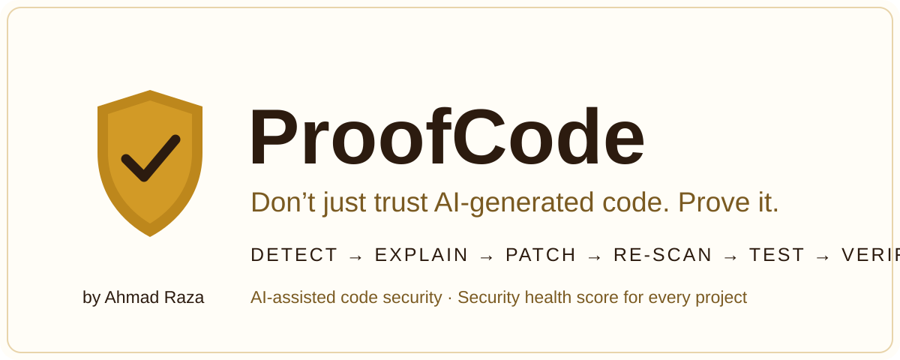
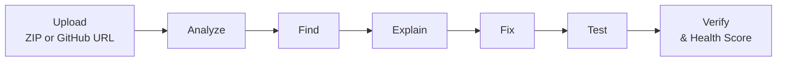

<p align="center">
  
</p>

<div align="center">

# ProofCode

**AI-assisted code security platform — Detect → Explain → Patch → Re-scan → Test → Verify**

Upload a project (ZIP or GitHub URL). ProofCode runs real static analysis, explains every
finding, patches what it safely can, re-scans to prove the fix, runs your own test suite,
and gives the project a Security Health Score.

    

[](https://proofcodeweb.onrender.com) [](https://github.com/Ahmadraza970/proofcode/releases/tag/v1.0.1)

**Live app: https://proofcodeweb.onrender.com**

**Android app (APK v1.0.1): https://github.com/Ahmadraza970/proofcode/releases/download/v1.0.1/ProofCode-v1.0.1.apk** (GitHub Release v1.0.1 — fixes the "App unavailable / Chrome is blocked" message some phones showed with v1.0)

</div>

## The workflow



1. **Upload** a `.zip` or paste a GitHub repo URL (`/upload`).
2. **Analyze** — clones/unzips into an isolated workspace (with a zip-bomb budget) and scans:
   - **JavaScript/TypeScript** via a real AST (typescript-estree): SQL injection, XSS (`innerHTML` / `insertAdjacentHTML`), `eval` / `new Function`, command injection, sensitive-error exposure.
   - **Python** via heuristics: SQL injection, `eval`, `pickle`, shell execution, OS commands.
   - **Secrets**: hardcoded credential-like values (placeholder-style values such as `demo` / `*-free` dummies are ignored).
3. **Find & explain** — each issue gets a severity, a plain-language why-it-matters, and a suggested fix.
4. **Fix** — deterministic patches first (e.g. `innerHTML` → `textContent`); riskier findings can use an LLM rewrite (Gemini, or an OpenRouter-compatible API). Every fix is **verified by re-scanning the rewritten line** — nothing is called "fixed" unless the detector stops firing. You can optionally bring your own AI key (Settings → "Your own AI key"): it stays in your browser and is sent only with your own fix requests.
5. **Test** — runs the project's own suite (`npm test` or `pytest`) in a scrubbed environment that never sees the server's secrets, plus a critical-findings check.
6. **Verify** — computes the resulting Health Score and verdict.

Health Score = `100 − Σ (open severity weights)`, floored at 5. Weights: critical 12, high 7, medium 4, low 1.

| Score | Band |
|---|---|
| 90–100 | **Excellent** |
| 75–89 | **Needs Attention** |
| 60–74 | **At Risk** |
| Below 60 | **Critical** |

### The 11 checks

**JavaScript / TypeScript** — parsed with a real AST (typescript-estree):

| Check | Severity |
|---|---|
| Dynamic SQL Query | Critical |
| Unsafe `innerHTML` & `insertAdjacentHTML` | High |
| `eval` / `new Function` Used | High |
| Dynamic Shell Command | High |
| Possible Hardcoded Secret | Medium |
| Internal Error Sent to Client | Medium |

**Python** — line-based checks in the style of Bandit:

| Check | Severity |
|---|---|
| Dynamic SQL Query | Critical |
| `eval` / `exec` Used | High |
| Untrusted `pickle.loads` | High |
| Shell Execution | High |
| `os.system` / `popen` With Variable | Medium |

Scanning is deterministic and runs on ProofCode's servers — nothing is sent to an AI
provider during a scan. Code goes to a provider only when you request an AI-generated fix.

## Security posture

- **Google sign-in only** (Supabase Auth). There is no API token and no unauthenticated
  route into projects: every API request carries the caller's sign-in session, which is
  validated against the Auth server on each call. Every project belongs to the signed-in
  user who created it — users can only see and act on their own projects. (The workspace
  owner's Google account, set server-side via `OWNER_EMAIL`, can also see projects created
  before sign-in existed.)
- Rate limits on the expensive endpoints (analyze, fix, verify, project creation).
- Uploaded code is analysed in a scratch workspace; test runs get an allow-listed
  environment only (no server secrets), and extraction is size/entry capped.
- The revival build passed an adversarial self-audit (bug-hunter method): 5 real findings
  were found, fixed, and re-verified — alongside a clean production build and an
  end-to-end suite that passes repeatedly.

## Quick start

```bash
npm install
cp .env.example .env.local   # fill in your own values
npm run dev                  # http://localhost:3000
```

Environment (all server-side; never expose the service-role key to the browser):

| Variable | Purpose |
|---|---|
| `SUPABASE_URL`, `SUPABASE_SERVICE_ROLE_KEY` | Persistence (projects, issues, history). Without them, an in-memory fallback is used and data is not persisted. |
| `NEXT_PUBLIC_SUPABASE_URL`, `NEXT_PUBLIC_SUPABASE_ANON_KEY` | Google sign-in (Supabase Auth) for the same Supabase project. Required on any real deployment — sign-in is the only way into the API. |
| `OWNER_EMAIL` | The workspace owner's Google account; it can also see projects created before sign-in existed. Everyone else sees only their own projects. |
| `GEMINI_API_KEY` (optional) | Enables LLM-assisted fixes (Gemini). Without a key, fixes that need an LLM are honestly refused; deterministic fixes still work. |
| `OPENAI_API_KEY`, `OPENAI_BASE_URL` (optional) | Fallback LLM provider (OpenRouter-compatible). |

## API (`/api/v1/*`)

Every endpoint requires a valid Google sign-in session: send the Supabase Auth access
token as `Authorization: Bearer <token>`. There are no unauthenticated project routes —
requests without a valid session get `401`, and each user can only access their own
projects.

| Method & path | Purpose |
|---|---|
| `GET /api/v1/projects` | List projects |
| `POST /api/v1/projects` | Create (JSON `{url}` or `.zip` multipart) |
| `GET /api/v1/projects/[id]` | Read one project |
| `DELETE /api/v1/projects/[id]` | Delete a project and its stored data |
| `POST /api/v1/analyze` | Run a scan |
| `POST /api/v1/issues/[issueId]/fix` | Fix one issue (deterministic → LLM) |
| `POST /api/v1/fix-all` | Attempt every open fixable issue |
| `POST /api/v1/verify` | Run tests + critical-findings check, produce a snapshot |

## Verification

```bash
npm run build              # next build (Turbopack) — type-checks + builds
node scripts/e2e-api.mjs   # full API E2E (server must be running)
```

## Project layout

- `lib/api/` — engine: `db` (Supabase persistence, health scores, per-user project ownership), `workspace` (clone/unzip/list), `scanner` (AST + heuristics), `fixer` (deterministic + LLM), `verify` (tests + snapshot), `analyze`, `auth` (Google sign-in session checks), `rate-limit`.
- `app/api/v1/` — Next.js route handlers for the API.
- `app/` + `components/` — the UI (pages, shared components, live-mode components), all driven by the real API — there is no demo data.
- `scripts/e2e-api.mjs` — end-to-end API test. `scripts/fixtures/vuln-node` — a deliberately vulnerable sample app used by the tests.

## Privacy

Projects you submit are analysed in a server-side scratch workspace; analysis results
(issues, scores, history) are stored in Supabase, tied to the Google account you signed in
with. Your code is sent to an AI provider **only** when you request an AI-generated fix
for a specific issue. Deleting a project deletes its stored data. The deployed site
carries the full policy at `/privacy`.

## Status & honest limits

- Revival build, verified 2026-11-04: clean production build, end-to-end suite all-pass
  (run repeatedly), Supabase persistence proven across restarts, and a real-project
  acceptance test on [MarkBot](https://github.com/Ahmadraza970/markbot) whose single
  finding was hand-checked as a false positive (a placeholder string, not a secret) —
  the detector was refined accordingly.
- Sign-in is Google-only (Supabase Auth); every project belongs to the account that
  created it, and the workspace owner account also manages projects created before
  sign-in existed.
- Live on Render (link at the top) since 2026-11-04, with an Android app (TWA wrapper of
  the live site) published as GitHub Release v1.0.1.

## Tech

Next.js 16 (App Router) · React 19 · TypeScript (strict) · Tailwind CSS v4 · shadcn/ui
(radix-nova) · Supabase Postgres · typescript-estree

---

<div align="center">

Made by **Ahmad Raza** — Ahmad Digital Studio · [ahmadrazaa.me](https://ahmadrazaa.me)

</div>
